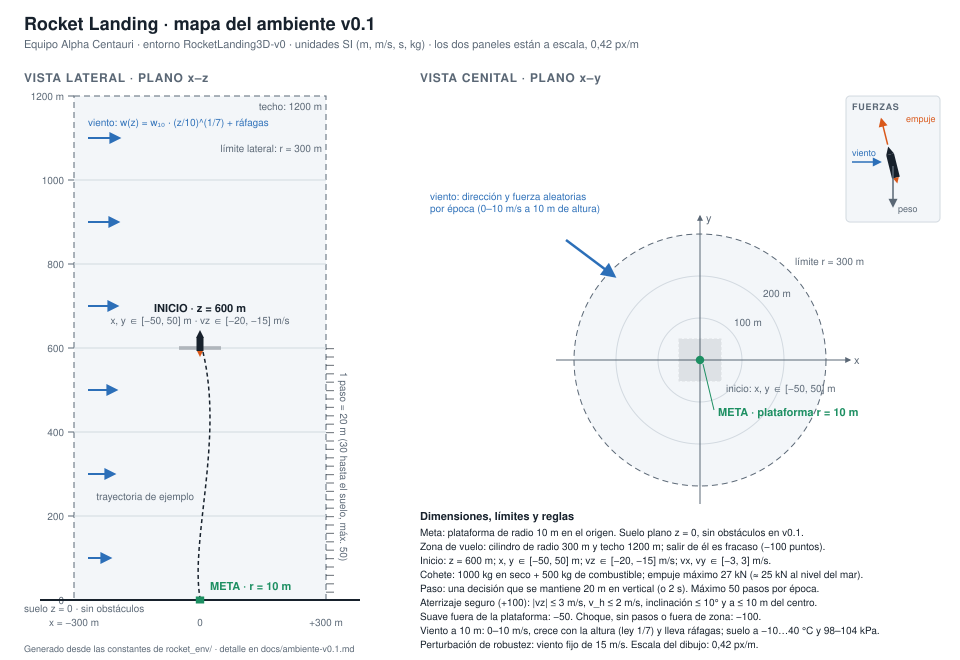

# Ambiente v0.1

**Equipo Alpha Centauri · ficha 02 Rocket Landing · 28 de octubre de 2026**

Misión de la ficha: *aterrizar en una plataforma con velocidad e inclinación seguras y combustible limitado.*

Esta ficha describe el ambiente tal como está implementado en [`rocket_env/`](../rocket_env/) (entorno Gymnasium `RocketLanding3D-v0`) y el agente de referencia con el que comprobamos que se puede aprender ([`agente_qlearning.py`](../agente_qlearning.py)). Todos los números salen del código; cuando un valor es una propuesta por calibrar, lo decimos. Las decisiones que dejamos abiertas están al final.

## Mision y mapa



El mundo es un cilindro de aire sobre un suelo plano. El eje z apunta hacia arriba y la plataforma está en el origen. Unidades SI en todo el ambiente: metros, segundos, kilogramos, newtons, kelvin, pascales.

| Elemento | Dónde | Dimensiones |
|---|---|---|
| Suelo | plano z = 0 | ilimitado, sin obstáculos en v0.1 |
| Meta: plataforma | círculo centrado en el origen | radio 10 m |
| Zona de vuelo | cilindro alrededor de la plataforma | radio 300 m, techo 1200 m; salir de él termina la época con fracaso |
| Inicio | z = 600 m, sobre un cuadrado centrado en la plataforma | x, y ∈ [−50, 50] m |
| Velocidad inicial | descendiendo con algo de deriva | vz ∈ [−20, −15] m/s; vx, vy ∈ [−3, 3] m/s |

Las "zonas inseguras" de la ficha son, en v0.1, todo lo que queda fuera del cilindro y todo el suelo salvo la plataforma. No hay rocas ni obstáculos (decisión pendiente).

**Parametría** (lo que configuramos antes de ejecutar; propuestas por calibrar):

| Parámetro de la ficha | Valor v0.1 | Por qué |
|---|---|---|
| Ancho de plataforma | radio 10 m (20 m de diámetro) | Es el 3 % del radio de la zona: obliga a corregir la deriva del viento, pero deja margen a un controlador sencillo. |
| Empuje máximo | 27 kN en vacío; 27 kN − p·0,02 m² ≈ 25 kN al nivel del mar | Relación empuje/peso 1,7 con el depósito lleno y 2,5 vacío: frena un descenso de 20 m/s en unos 3 s sin ser incontrolable. |
| Combustible inicial | 500 kg (masa en seco 1000 kg), impulso específico 250 s | A empuje máximo dura 49 s; flotando con el depósito lleno, 83 s. Alcanza para aterrizar (60–75 s de vuelo) pero no para flotar hasta agotar los pasos. |
| Viento lateral | velocidad del aire a 10 m de 0–10 m/s con dirección aleatoria por época; crece con la altura; ráfagas de 1,5 m/s | Modelado como velocidad del aire, no como fuerza: entra por el arrastre, así su efecto depende de la densidad del aire y de la velocidad relativa del cohete. |

## Variables y unidades

Estado del mundo (lo que el simulador guarda) y qué parte ve el agente:

| Variable | Significado | Unidad | Rango | Visible para el agente |
|---|---|---|---|---|
| x, y | posición horizontal respecto al centro de la plataforma | m | [−300, 300]; fuera, fin de época | sí |
| z | altitud sobre el suelo | m | [0, 1200]; fuera, fin de época | sí |
| vx, vy, vz | velocidad | m/s | sin tope; típicas [−30, 30] | sí |
| d = (dx, dy, dz) | eje del cohete, igual a la dirección del último empuje | vector unitario | — | como inclinación θ = arccos(dz), en grados [0, 180) |
| m_c | combustible | kg | [0, 500] | sí, como fracción [0, 1] |
| T_m | temperatura del motor | K | [T_aire, ≈900] | sí |
| motor | motor encendido | 0/1 | — | sí |
| sobrecalentado | motor bloqueado hasta enfriarse por debajo de 800 K | 0/1 | — | **no** (pendiente) |
| k | pasos usados | — | [0, 50] | sí, como pasos restantes 1 − k/50 |
| t | tiempo de vuelo | s | [0, 100] | no directamente (se deduce de los pasos) |
| w = (wx, wy, wz) | viento en la posición del cohete: medio + ráfaga | m/s | aprox. [−25, 25] | sí |
| w₁₀, φ | velocidad media del viento a 10 m y su dirección; fijos por época | m/s, rad | [0, 10], [0, 2π) | no directamente (solo a través de w) |
| g_r | estado de las ráfagas (proceso de Ornstein-Uhlenbeck) | m/s | — | no (solo su efecto en w) |
| T₀, p₀ | temperatura y presión en el suelo; fijas por época | K, Pa | [263, 313] (−10…40 °C), [98 000, 104 000] | no directamente: el agente ve T(z) y p(z) |
| T(z), p(z), ρ(z) | temperatura, presión y densidad del aire en la posición | K, kPa, kg/m³ | ρ entre 1,09 y 1,38 | T y p sí; ρ se deduce |

Constantes del cohete y de la atmósfera (fijas en v0.1):

| Constante | Valor | Constante | Valor |
|---|---|---|---|
| masa en seco | 1000 kg | gravedad g₀ | 9,80665 m/s² |
| empuje en vacío T_vac | 27 000 N | gradiente térmico L | 0,0065 K/m |
| área de salida de la tobera A_e | 0,02 m² | constante del aire R | 287,05 J/(kg·K) |
| impulso específico Isp | 250 s | tiempo de las ráfagas τ | 3 s |
| coeficiente de arrastre C_d | 0,8 | intensidad de las ráfagas σ | 1,5 m/s (vertical ×0,3) |
| área frontal A | 3 m² | calentamiento del motor | 30 K/s a acelerador 1 |
| temperatura máxima del motor | 900 K (vuelve a arrancar por debajo de 800 K) | enfriamiento del motor | 0,05 1/s hacia T_aire |

## Observaciones y acciones

**Observación**: vector de 16 números en unidades físicas, sin normalizar (decisión pendiente).

| Índice | Contenido | Unidad |
|---|---|---|
| 0–2 | posición x, y, z | m |
| 3–5 | velocidad vx, vy, vz | m/s |
| 6–8 | viento en la posición del cohete (wx, wy, wz) | m/s |
| 9 | temperatura del aire | K |
| 10 | presión del aire | kPa |
| 11 | temperatura del motor | K |
| 12 | combustible restante | fracción 0–1 |
| 13 | motor encendido | 0/1 |
| 14 | pasos restantes | fracción 0–1 |
| 15 | inclinación del eje respecto a la vertical | grados |

Respecto a la ficha: el "desplazamiento a la plataforma" es (x, y) porque la plataforma está en el origen, y no hace falta observar el "contacto" porque el contacto termina la época. El agente **no** observa las ráfagas futuras, si el motor está bloqueado por sobrecalentamiento ni el tiempo absoluto.

**Acción del entorno**: vector continuo de 5 números (`Box`).

| Índice | Contenido | Rango |
|---|---|---|
| 0 | motor: > 0 encendido, ≤ 0 apagado | [−1, 1] |
| 1 | acelerador, fracción del empuje máximo | [0, 1] |
| 2–4 | dirección del empuje (x, y, z); el entorno la normaliza | [−1, 1] cada uno |

Respecto a la ficha: la "potencia del motor principal" es el acelerador; el "torque de orientación" se simplifica a "dirección del empuje": el eje del cohete sigue al empuje sin dinámica de rotación (decisión pendiente).

**Catálogo discreto del agente de referencia**. El Q-learning no usa el vector continuo directamente; elige dos cosas por paso y las traduce:

- Motor (6 opciones): apagado, o encendido con empuje igual a ×0,6, ×0,9, ×1,0, ×1,1 o ×1,4 el peso actual del cohete. Se traduce a acelerador con la masa y la presión observadas, así "×1,0" siempre significa "flotar", con el depósito lleno o vacío.
- Dirección (5 opciones): recto hacia arriba, o inclinado hacia +x, −x, +y o −y con componente lateral 0,10 (5,7° de inclinación, por debajo del límite de 10° al aterrizar).

## Dinamica

Qué pasa cuando el agente actúa:

1. **Paso del agente.** La acción se mantiene hasta que el cohete se ha desplazado 20 m en vertical (subiendo o bajando) o hasta que pasan 2 s, lo que ocurra antes. Dentro del paso la física avanza con Euler explícito cada Δt = 0,1 s: entre 7 y 20 subpasos según la velocidad.
2. **Empuje.** T = (T_vac − p(z)·A_e) · acelerador, aplicado en la dirección d (unitaria). Solo si el motor está encendido, queda combustible y no está sobrecalentado. A más presión exterior, menos empuje (unos 2 kN de pérdida al nivel del mar). Consumo ṁ = T / (Isp · g₀).
3. **Arrastre con viento.** D = −½ ρ(z) C_d A |v − w| (v − w). Es la única vía por la que el viento mueve el cohete: un viento de 10 m/s sobre un cohete quieto empuja con unos 130 N (0,09 m/s² con el depósito lleno), suficiente para sacarlo de la plataforma si no corrige.
4. **Gravedad.** −m g₀ en z, con m = 1000 kg + combustible.
5. **Integración.** a = (T·d + D)/m + g; v ← v + a·Δt; r ← r + v·Δt.
6. **Atmósfera (ISA desde el suelo).** T(z) = T₀ − 0,0065·z; p(z) = p₀ · (T/T₀)^(g₀ / (R·0,0065)); ρ = p / (R·T). Entre la época más fría y densa y la más cálida y ligera, la densidad cambia un 25 %, y con ella el arrastre.
7. **Viento.** w(z) = w₁₀ · (max(z, 1)/10)^(1/7) + g_r, con ráfaga g_r que sigue un proceso de Ornstein-Uhlenbeck: dg_r = −g_r/τ · dt + σ·√(2·dt/τ)·ξ, con τ = 3 s, σ = 1,5 m/s y la componente vertical reducida a 0,3. A 600 m el viento medio es 1,8 veces el de 10 m.
8. **Motor térmico.** dT_m/dt = 30 · acelerador − 0,05 · (T_m − T_aire). Si T_m ≥ 900 K el motor se bloquea hasta enfriarse por debajo de 800 K. Con el agente de referencia el motor llega a unos 600 K: el límite existe pero no se alcanza (pendiente calibrar).
9. **Inclinación.** El eje del cohete es la dirección del último empuje; θ = arccos(dz).
10. **Fin del paso.** Se comprueba el resultado (sección *Éxito, fracaso y límite de tiempo*), se suma un paso y se calcula la recompensa. Si se toca el suelo a mitad de paso, el paso termina ahí.

## Recompensa

Dos partes: una recompensa **por paso** que guía la aproximación y una recompensa **final** según cómo termina la época.

**Por paso:** r = Φ(s′) − Φ(s) − 0,1 · combustible gastado en el paso (kg), con

    Φ(s) = −d_h / 5 − v_h − |vz − v_seg(z)| − z / 10
    v_seg(z) = −clip(0,08 · z, 1,5, 30)   (m/s; bajar rápido arriba y despacio cerca del suelo)

donde d_h = √(x² + y²) es la distancia horizontal a la plataforma y v_h = √(vx² + vy²) la velocidad horizontal. Φ es un *potencial*: sumada a lo largo de la época, la parte de aproximación vale Φ(final) − Φ(inicio), unos +80 puntos como máximo (de Φ ≈ −82 en la salida a Φ ≈ −2 posado en la plataforma), sea cual sea el camino. Dar vueltas o flotar no la aumenta. El combustible resta hasta 50 puntos si se vacía el depósito.

**Al terminar:**

| Resultado | Cuándo | Puntos |
|---|---|---|
| aterrizaje | contacto con \|vz\| ≤ 3 m/s, v_h ≤ 2 m/s, inclinación ≤ 10° y a ≤ 10 m del centro | **+100** |
| fuera de plataforma | contacto suave (las mismas tres condiciones) pero a más de 10 m del centro | **−50** |
| choque | contacto que incumple alguna de las tres condiciones de suavidad | **−100** |
| sin pasos | agota los 50 pasos sin tocar el suelo | **−100** |
| fuera de zona | d_h > 300 m o z > 1200 m | **−100** |

Por qué estos valores: aterrizar y chocar son simétricos (±100) y dominan sobre la aproximación (+80) y el combustible (−50), así que la única forma de terminar con una recompensa alta es aterrizar. "Fuera de plataforma" vale la mitad del choque porque la parte difícil (posarse suave) está hecha, pero la misión no.

Recompensa total típica por resultado, en las 5000 épocas de entrenamiento del agente de referencia:

| Resultado | Épocas | Recompensa media | Mínima | Máxima |
|---|---|---|---|---|
| aterrizaje | 1653 | +152,8 | +134,9 | +167,6 |
| fuera de plataforma | 159 | +0,8 | −18,0 | +12,8 |
| choque | 2727 | −72,9 | −136,6 | −34,3 |
| sin pasos | 189 | −95,3 | −162,8 | −60,2 |
| fuera de zona | 272 | −127,4 | −210,3 | −107,1 |

Las bandas no se solapan: un aterrizaje siempre vale más que cualquier otro final. "Fuera de plataforma" queda cerca de cero (ver la trampa 2 al final).

## Exito, fracaso y limite de tiempo

**Éxito.** Tocar el suelo (z ≤ 0) con |vz| ≤ 3 m/s, v_h ≤ 2 m/s, inclinación ≤ 10° y a ≤ 10 m del centro de la plataforma. La ficha pide además "estabilidad durante un intervalo"; en v0.1 la época termina en el contacto (decisión pendiente).

**Fracaso.** Cualquiera de los otros cuatro resultados de la tabla anterior: choque, fuera de plataforma, fuera de zona, sin pasos.

**Límite de tiempo.** 50 pasos. Desde 600 m hacen falta 30 pasos de 20 m bajando en línea recta; los 20 restantes son el margen para frenar (cerca del suelo cada paso dura 2 s y recorre menos de 20 m) y para corregir la deriva. Como cada paso dura 2 s como máximo, una época dura 100 s como máximo. Bajar desde 800 m (nuestra primera versión) dejaba demasiado poco margen: el controlador hecho a mano necesitaba 45 pasos.

## Metricas e incidente

**Tres métricas**, medidas en 200 épocas de evaluación sin exploración y con semillas (meteorología y punto de salida) que no aparecen en el entrenamiento:

1. **Tasa de aterrizajes seguros** (%): la medida de la misión.
2. **Velocidad de contacto** (m/s): media de |vz| en las épocas que tocan el suelo; dice *cómo* de bien aterriza, no solo si lo hace.
3. **Error de posición final** (m): distancia al centro de la plataforma al terminar; mide la corrección de la deriva.

Complementaria: combustible gastado (kg). Durante el entrenamiento medimos además **cuántas épocas tarda en aterrizar**: la primera vez y la época en que la media móvil de 100 épocas alcanza el 25, el 50 y el 75 % de aterrizajes.

**Incidente / perturbación:** viento lateral fijo de 15 m/s a 10 m de altura, fuera del rango 0–10 m/s del entrenamiento, con dirección aleatoria por época. Se activa con `options={"viento": 15}` en `reset` o con `python cli.py evaluar --viento 15`. Comparamos las mismas 200 épocas con y sin perturbación.

**Resultados del agente de referencia** (Q-learning con dos tablas, 5000 épocas, unos 2 minutos de entrenamiento; detalles en `agente_qlearning.py` y `entrenamiento.py`):

| Épocas hasta… | Época |
|---|---|
| el primer aterrizaje | 1785 |
| aterrizar el 25 % de las veces (media de 100 épocas) | 2697 |
| aterrizar el 50 % | 2779 |
| aterrizar el 75 % | 2970 |

| Métrica (las mismas 200 épocas) | Condiciones normales (viento 0–10 m/s) | Perturbación (viento 15 m/s) |
|---|---|---|
| 1. Tasa de aterrizajes seguros | 157 / 200 (78 %) | 76 / 200 (38 %) |
| 2. Velocidad de contacto | 1,95 m/s | 1,98 m/s |
| 3. Error de posición final | 5,5 m | 33,6 m |
| Combustible gastado | 272 kg | 275 kg |
| Cómo terminan | aterrizaje 157, fuera de plataforma 10, choque 33 | aterrizaje 76, fuera de plataforma 6, choque 118 |

Lectura: con viento fuerte el agente sigue frenando igual de bien en vertical (la velocidad de contacto no cambia), pero pierde el control lateral: el error de posición se multiplica por seis y los 118 choques se deben todos a llegar al suelo con más de 2 m/s de velocidad horizontal, arrastrado por el viento (ninguno a la velocidad vertical ni a la inclinación). Un candidato que aguante la perturbación tendrá que inclinarse más de los 5,7° del catálogo actual o anticipar la deriva.

El agente aprende con dos tablas Q pequeñas (297 valores en total): una para el motor, indexada por altitud (6 intervalos) y velocidad vertical (7 intervalos), y otra para la dirección, indexada por hacia dónde derivará el cohete en 4 s en cada eje horizontal (3 intervalos por eje). Exploración ε de 1 a 0,02 en el 60 % de las épocas; tasa de aprendizaje de 0,1 a 0,01; descuento 0,99. Cada 250 épocas se evalúa sin explorar en 50 épocas y nos quedamos con la mejor versión. Es un agente de referencia para comprobar que el ambiente se puede aprender y evaluar, no el modelo final del proyecto.

## Cinco transiciones

Cinco pasos consecutivos del agente de referencia ya entrenado, en la época de evaluación con semilla 10 000 000 (reproducible con `python cli.py transiciones`). La observación se resume a lo que cambia; "fin" indica si la época termina.

Condiciones de la época: suelo a 13 °C y 99,9 kPa (a 600 m el agente lee 9,1 °C y 92,4 kPa), viento de 14 m/s a 600 m soplando sobre todo hacia +y.

| # | Observación (antes del paso) | Acción del agente → acción del entorno | Nuevo estado (después del paso) | Recompensa | Fin |
|---|---|---|---|---|---|
| 1 | z 600,0 m; vz −19,6 m/s; (x, y) = (31,7, 10,1) m; vy +1,1 m/s; viento (−6,3, +12,9) m/s; combustible 100 %; inclinación 0° | empuje ×0,6 inclinado a −y → motor encendido, acelerador 0,35, dirección (0, −0,10, 1) | z 578,5 m; vz −23,0; (33,0, 11,0); vy +0,8; comb. 99 %; incl. 5,7° · 10 subpasos de física (1,0 s) | +5,24 | no |
| 2 | el nuevo estado del paso 1 | motor apagado → motor −1, acelerador 0 | z 556,8 m; vz −30,3; (33,9, 11,8); vy +1,0; comb. 99 %; incl. 0° · 8 subpasos | +8,54 | no |
| 3 | el nuevo estado del paso 2 | empuje ×1,1 a −y → acelerador 0,65, dirección (0, −0,10, 1) | z 536,1 m; vz −29,0; (34,7, 12,3); vy +0,5; motor 305 K; comb. 98 % · 7 subpasos | +1,12 | no |
| 4 | el nuevo estado del paso 3 | empuje ×1,1 a −y → acelerador 0,64 | z 513,6 m; vz −27,5; (35,4, 12,4); vy −0,1; motor 319 K; comb. 97 % · 8 subpasos | +0,39 | no |
| 5 | el nuevo estado del paso 4 | empuje ×1,1 a −y → acelerador 0,64 | z 492,3 m; vz −26,1; (36,0, 12,1); vy −0,6; viento (−6,6, +13,8); motor 333 K; comb. 96 % · 8 subpasos | +0,01 | no |

Lectura de las cinco:

1. El agente sale con el motor suave e inclinado a −y, contra el viento que sopla hacia +y. Gana +5,2 porque baja hacia la velocidad segura (−30 m/s a 600 m) y se acerca al suelo.
2. Apaga el motor para acelerar la caída hasta la velocidad segura: el error de descenso cae de 7 a 0 m/s y es el paso mejor pagado (+8,5).
3. – 5. Con empuje ×1,1 (un 10 % más que su peso) sostiene unos −28 m/s. La recompensa por paso tiende a cero porque Φ apenas cambia: lo que gana por bajar 20 m lo pierde por frenarse. La deriva lateral se corrige: vy pasa de +1,1 a −0,6 m/s mientras el viento sigue empujando hacia +y.

Ninguna de las cinco termina la época. Esta época sigue hasta el paso 38 y se posa suave (1,0 m/s vertical, 1,8 m/s horizontal, 5,7° de inclinación) pero a 16,2 m del centro: termina **fuera de plataforma** (−50) con recompensa total −5,5. Es uno de los 10 casos de 200 de la evaluación, y justo el caso de la trampa 2.

## Posibles trampas y decisiones pendientes

**Trampa 1 (el reto de la ficha): acumular premio flotando sin aterrizar.** No compensa, por tres motivos: la recompensa de aproximación es un potencial (sumada a lo largo de la época solo depende de dónde empieza y dónde acaba, así que flotar aporta 0), cada kilogramo de combustible resta 0,1 y agotar los 50 pasos vale −100. Lo comprobamos con políticas fijas en 50 épocas de evaluación:

| Política fija (50 épocas de evaluación) | Recompensa media | Pasos | Cómo termina |
|---|---|---|---|
| flotar: frena y mantiene la altura con empuje = peso | −204,8 | 40 | fuera de zona 32 (el viento lo saca del cilindro), sin pasos 18; gasta 413 kg de combustible |
| empuje = peso desde la salida, sin frenar | −93,3 | 31 | choque 39, fuera de zona 11 |
| subir siempre (empuje ×1,4) | −261,0 | 33 | fuera de zona 50 (sale por el techo) |
| frenar siempre (empuje ×1,1) | −268,3 | 44 | fuera de zona 50 |
| caída libre (motor apagado) | −113,1 | 27 | choque 50 |

Flotar es la peor opción después de subir: no suma aproximación (la pierde al derivar con el viento: Φ baja de −82 a unos −156), gasta casi todo el combustible y acaba con −100 por agotar los pasos o salir de la zona. Un aterrizaje típico vale unos +150 (tabla de la sección *Recompensa*).

**Trampa 2: aterrizar suave fuera de la plataforma.** Como la aproximación suma hasta +80 y el resultado vale −50, posarse suave junto a la plataforma puede acabar con recompensa total positiva: en el entrenamiento, media +0,8 y máximo +12,8 (tabla de la sección *Recompensa*). Es una forma de ganar puntos sin cumplir la misión. Mitigación actual: la plataforma vale 150 puntos más, así que el agente de referencia solo termina así en el 5 % de las épocas de evaluación, y la métrica "fuera de plataforma" lo vigila. La época de la sección *Cinco transiciones* es uno de esos casos. Pendiente: hacer la penalización proporcional a la distancia al centro.

**Trampa 3: chocar rápido para ahorrar combustible.** Chocar vale −100 y el ahorro máximo de combustible son 50 puntos, así que un choque nunca supera a un aterrizaje (diferencia mínima de 150 puntos). Comprobado: la política "caída libre" de la tabla anterior es la peor de todas.

**Decisiones pendientes** (para discutir con el otro equipo):

1. Obstáculos y zonas inseguras en el suelo, como en la ilustración de la ficha. v0.1 no los tiene.
2. "Estabilidad durante un intervalo" tras el contacto. Ahora la época termina al tocar el suelo.
3. Dinámica de rotación real (torque e inercia) en lugar de que el eje siga instantáneamente a la dirección del empuje. Cambiaría la acción a "potencia + torque", como dice la ficha.
4. Hacer observable el bloqueo por sobrecalentamiento, y calibrar el límite térmico para que importe (hoy el agente llega a 600 K de 900).
5. Normalizar la observación (hoy va en unidades físicas crudas, mezclando metros con kelvin).
6. Penalización explícita por tiempo, que la ficha pide. Hoy solo actúa a través del límite de pasos y del combustible.
7. Penalización de "fuera de plataforma" proporcional a la distancia (trampa 2).
8. Definición del paso: "20 m de desplazamiento vertical" cuenta también subidas. ¿Debe contar solo descensos?
9. Rango del viento y de las ráfagas, y la altura de salida: 600 m se eligió para que 50 pasos alcancen; conviene justificarlo con más datos.
10. Viento como velocidad del aire (elegido) frente a viento como fuerza. La ficha deja abierto el modelo; el nuestro acopla el viento a la densidad del aire, que a su vez depende de la temperatura y la presión.

## Anexo: cómo reproducir

```bash
python cli.py entrenar               # entrena 5000 épocas y dice cuántas tarda en aterrizar
python cli.py ver                    # una época del modelo entrenado, paso a paso
python cli.py evaluar --viento 15    # las tres métricas, con y sin la perturbación
python cli.py transiciones           # las cinco transiciones de esta ficha
```

`python cli.py entrenar` genera además `aprendizaje.html`, una página con las curvas de aprendizaje y la repetición de épocas en 3D.
