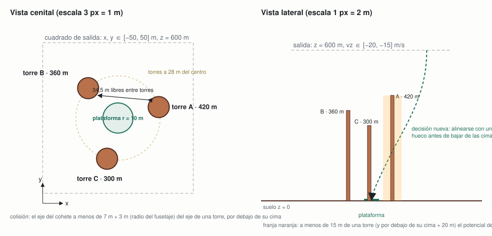

# Ambiente v0.2 · nivel 2: obstáculos junto a la plataforma

**Equipo Alpha Centauri · ficha 02 Rocket Landing · 5 de noviembre de 2026**

Misión de la ficha: *aterrizar en una plataforma con velocidad e inclinación seguras y combustible limitado.* El nivel 2 añade **la decisión de ruta**: tres torres rodean la plataforma y hay que elegir por qué hueco entrar antes de bajar de sus cimas.

Esta ficha describe solo lo que cambia respecto al nivel 1 ([ambiente-v0.1.md](ambiente-v0.1.md)): el entorno Gymnasium `RocketLanding3D-N2-v0` ([`rocket_env/nivel2.py`](../rocket_env/nivel2.py)) hereda toda la física, la atmósfera, el viento, el combustible, los pasos y las reglas de aterrizaje del nivel 1 sin tocar un número. Lo que no se menciona aquí es igual que en v0.1.

## Mision y mapa



| Elemento | Dónde | Dimensiones |
|---|---|---|
| Plataforma, zona de vuelo, salida | como en v0.1 | radio 10 m; cilindro de 300 × 1200 m; salida a 600 m sobre x, y ∈ [−50, 50] m |
| Torre A | azimut 15°: (27,05, 7,25) m | radio 7 m, altura 420 m |
| Torre B | azimut 135°: (−19,8, 19,8) m | radio 7 m, altura 360 m |
| Torre C | azimut 255°: (−7,25, −27,05) m | radio 7 m, altura 300 m |

Las tres torres están a 28 m del centro, a 120° entre sí, con 34,5 m libres entre dos vecinas (28 m descontando los 6 m de fuselaje). Ninguna toca el círculo de aterrizaje: su superficie queda a 21 m del centro, 11 m fuera de la plataforma, así que bajar en vertical sobre el centro sigue siendo seguro. Están dentro del cuadrado de salida y sus cimas (300–420 m) están por debajo de la altitud de salida (600 m): desde el 30 % del cuadrado de salida la ruta recta al centro atraviesa una torre, y con el viento la cifra sube.

**Por qué este candidato.** De los tres que se propusieron ([nivel-2-propuesta.md](nivel-2-propuesta.md)) el equipo eligió el C (obstáculos). Cumple lo que pide la guía para el nivel 2, "más decisiones (rutas u obstáculos)", con una decisión que se ve en el replay 3D: alinearse con un hueco antes de bajar de las cimas. Las torres se colocaron tras medir la dificultad: con dos torres bajas a un lado (primer intento, 120–180 m) el modelo recomendado del nivel 1 solo chocaba el 2 % de las veces, porque ya está centrado sobre la plataforma mucho antes de bajar a esa altura.

## Variables y unidades

Todo lo de v0.1, más:

| Variable | Significado | Unidad | Rango | Visible para el agente |
|---|---|---|---|---|
| (x_k, y_k, r_k, h_k) | posición, radio y altura de la torre k; fijas | m | tabla anterior | sí, como posición relativa y altura restante (ver observación) |
| d_k | distancia horizontal del eje del cohete a la superficie de la torre k, descontando el radio del fuselaje (3 m) | m | negativa dentro de la torre | no directamente (se deduce); está en `info["distancia_obstaculo_m"]` |

Constante nueva: radio del fuselaje 3 m (el cohete sigue siendo una masa puntual para la física; el radio solo se usa para la colisión).

## Observaciones y acciones

**Observación**: 25 valores. Los 16 primeros son exactamente los del nivel 1 (misma semilla, mismos valores); después, por cada torre en orden A, B, C: `x_k − x`, `y_k − y`, `h_k − z` (cuánto queda de torre por encima del cohete; negativo cuando ya la ha superado). Un modelo del nivel 1 no puede usarse tal cual (la red espera 16 entradas): es una **familia nueva de modelos**. `AdaptadorN1` recorta la observación a los 16 valores del nivel 1 para evaluar un modelo del nivel 1 aquí, a ciegas respecto a las torres.

**Acción**: la misma del nivel 1 (motor, acelerador y dirección del empuje). Los agentes PPO siguen usando la acción relativa v2.

## Dinamica

Igual que en v0.1. La única regla nueva se comprueba en cada paso de física (0,1 s): si el cohete está por encima del suelo y por debajo de la cima de una torre (z < h_k) y su eje pasa a menos de r_k + 3 m del eje de la torre (d_k ≤ 0), la época termina con "colisión". La comprobación va antes que las del suelo y la zona.

## Recompensa

Potencial del nivel 1 menos un castigo de proximidad:

Φ₂ = Φ₁ − 8 · Σ_k max(0, 1 − d_k / 15) · [z < h_k + 20]

Es decir, a menos de 15 m de la superficie de una torre y por debajo de su cima más 20 m, el potencial baja hasta 8 puntos por torre (los mismos que pegarse a ella). Como es una diferencia de potencial, no cambia qué política es óptima: solo acerca la señal del −100 de la colisión al momento en que el cohete se acerca a la torre. Sobre el centro de la plataforma el castigo es cero (las torres quedan a 18 m del fuselaje).

Resultado nuevo al terminar:

| Resultado | Cuándo | Puntos |
|---|---|---|
| colisión | choca con una torre | **−100** |

Los otros cinco resultados y sus puntos no cambian.

## Exito, fracaso y limite de tiempo

Éxito, fracaso y límite de 50 pasos como en v0.1; "colisión" se suma a los fracasos. Es un estado final del cohete, así que se informa con `terminated=True` (como "choque"), no con `truncated`.

## Metricas e incidente

Las tres métricas de v0.1 (tasa de aterrizajes seguros, velocidad de contacto, error de posición) en la misma suite v1 (200 épocas, semillas desde 10 000 000, con y sin viento de 15 m/s), más el recuento de colisiones.

**Cómo se mide la dificultad del nivel.** Los controladores del nivel 1 juegan en el nivel 2 sin ver las torres (`AdaptadorN1`); lo que pierden es lo que cuesta el nivel:

| Controlador (nivel 1) | En el nivel 1 | En el nivel 2, a ciegas | Colisiones |
|---|---|---|---|
| heurístico hecho a mano (`experimento1.py`) | 200/200 | 169/200 (85 %) | 31 |
| `ppo-v2-v0.1-s0`, recomendado del nivel 1 (97 %) | 194/200 | 143/200 (72 %) | 53 |
| `base-v0.1-s0`, Q-learning | 157/200 | 117/200 (58 %) | 50 |
| aleatorio | 0/200 | 0/200 | 7 (el resto choca contra el suelo) |

Comandos: `python cli.py evaluar --run ppo-v2-v0.1-s0 --ambiente RocketLanding3D-N2-v0`.

**Incidente / perturbación:** el mismo viento de 15 m/s de v0.1 (`options={"viento": 15}`), que aquí además empuja al cohete hacia las torres.

**Resultados de los agentes del nivel 2:** ver más abajo, sección "Experimentos del nivel 2" (se rellena con cada ejecución; las hipótesis y decisiones están en `configs/`).

## Cinco transiciones

Cinco pasos consecutivos del modelo recomendado del nivel 2 (`ppo-n2-transfer-v0.2-s0`) en la época de evaluación con semilla 10 000 000 (`python cli.py transiciones --run ppo-n2-transfer-v0.2-s0`). La observación se resume a lo que cambia; la columna "torres" son, por torre (A, B, C), `x_k − x`, `y_k − y` y `h_k − z` en metros: la salida de esta época está casi encima de la torre A (a 5 m en x y 3 m en y de su eje, 180 m por encima de su cima), así que la decisión de ruta es inmediata.

| # | Observación (resumen) | Torres (A · B · C) | Acción | Recompensa | Fin |
|---|---|---|---|---|---|
| 1 | pos (31,7, 10,1, 600,0) m · vel (1,4, 1,1, −19,6) m/s · viento (−6,3, 12,9) m/s · comb. 1,00 | (−5, −3, −180) · (−51, 10, −240) · (−39, −37, −300) | motor apagado | +10,14 | no |
| 2 | pos (32,9, 11,2, 578,2) · vel (1,2, 1,4, −27,9) · incl. 0° | (−6, −4, −158) · (−53, 9, −218) · (−40, −38, −278) | empuje ×0,14 · 9° hacia −x | +0,82 | no |
| 3 | pos (33,6, 12,2, 556,5) · vel (1,0, 1,5, −33,2) · incl. 8,7° | (−7, −5, −137) · (−53, 8, −197) · (−41, −39, −257) | motor apagado | −3,25 | no |
| 4 | pos (34,2, 13,2, 534,8) · vel (0,9, 1,7, −38,3) · incl. 0° | (−7, −6, −115) · (−54, 7, −175) · (−41, −40, −235) | empuje ×0,55 · 9° hacia −x | +0,60 | no |
| 5 | pos (34,6, 14,2, 511,2) · vel (0,4, 1,6, −40,1) · incl. 9,5° | (−8, −7, −91) · (−54, 6, −151) · (−42, −41, −211) | empuje ×0,42 · 10° hacia −x | −0,09 | no |

Lectura: en los cinco primeros pasos el agente deja caer el cohete (la recompensa del paso 1 es la mejora del potencial por bajar) y empieza a inclinarse hacia −x para frenar la deriva hacia +x que lo aleja de la plataforma y lo mantiene sobre la torre A. La época termina en aterrizaje (34 pasos). El potencial todavía no castiga la cercanía de la torre: el cohete está 91 m por encima de su cima en el paso 5.

## Posibles trampas y decisiones pendientes

- **Flotar sobre las torres.** Un agente podría quedarse por encima de 420 m hasta agotar los pasos para evitar el riesgo; lo evita el −100 de "sin pasos" y el término −z/10 del potencial, que ya existían.
- **Bordear por fuera.** Rodear las torres por fuera de los 35 m y entrar después en horizontal por debajo de las cimas es legal, pero gasta combustible y pasos; el castigo de proximidad lo hace menos atractivo que entrar por un hueco.
- **Radio del fuselaje.** 3 m es el radio del cuerpo, no de las patas desplegadas (6 m). Decidimos que las patas no cuentan para la colisión; se puede endurecer en una versión 0.3.
- **Las torres no proyectan sombra ni viento.** No alteran el viento (no hay estela) ni la atmósfera. Decisión pendiente para el nivel 3.
- **Orden fijo de las torres en la observación.** El agente aprende "torre A" como la de 420 m; si cambiara la disposición, sería una versión nueva del ambiente.

## Experimentos del nivel 2

Se documentan en `configs/<run_id>.json` (hipótesis, cambio, presupuesto, estado y decisión); resumen (suite v1, 200 épocas, viento 0–10 m/s):

| Ejecución | Hipótesis (resumen) | Presupuesto | Aterrizajes | Colisiones | Con viento de 15 m/s | Estado |
|---|---|---|---|---|---|---|
| referencia: `ppo-v2-v0.1-s0` a ciegas | modelo del nivel 1 con `AdaptadorN1` | — | 143 (72 %) | 53 | — | referencia de dificultad |
| `ppo-n2-v0.2-s0` | la receta del nivel 1 aprende el nivel 2 desde cero | 600 000 pasos · 21 376 épocas · 12,7 min | 16 (8 %) | 54 | 2 % | rechazado: frena (97 contactos suaves) pero fuera de la plataforma; trata la plataforma rodeada de torres como zona peligrosa |
| `ppo-n2-transfer-v0.2-s0` | partir de la política del nivel 1 y aprender solo a esquivar | 600 000 pasos · 19 940 épocas · 13,9 min | 153 (77 %) | 42 | 42 % (58 colisiones) | referencia: fue el recomendado del nivel 2 (catálogo v3) y es el "anterior" para rollback; aterriza en su 4.ª época, esquivar mejora poco |
| `ppo-n2-transfer-1m5-v0.2-s0` | el presupuesto era el cuello de botella: con 1,5 M de pasos la transferencia aprende a esquivar | 1 500 000 pasos · 49 460 épocas · 42,7 min | **172 (86 %)** | **27** | 56 % (42 colisiones) | **seleccionado**: recomendado del nivel 2 (catálogo v4); contacto 1,31 m/s, error 7,0 m, 177 kg |

Con viento de 15 m/s (fuera del rango de entrenamiento) el viento empuja al cohete hacia las torres: las colisiones del recomendado suben de 27 a 42 y la tasa cae a 56 %. Es el incidente del nivel 2 y la perturbación candidata para el nivel 3.

Cómo evolucionó el modelo desde cero (resultado de cada cuarto de las 21 376 épocas de entrenamiento, con exploración): choque 73 → 76 → 69 → 56 %, colisión 24 → 21 → 23 → 26 %, fuera de plataforma 1 → 3 → 7 → 15 %, aterrizaje 0 → 0 → 1 → 2 %. Aprende a frenar antes que a entrar entre las torres.

Transferencia (`entrenar_ppo.py --desde`): se copian los 11 tensores de la red del nivel 1; en la primera capa de la política y la del valor (ahora 25 entradas) las 16 columnas originales se copian y las 9 nuevas empiezan en cero, y la normalización de observaciones se copia para las 16 comunes. Antes de entrenar, el modelo transferido juega exactamente como el del nivel 1 a ciegas (29/40 aterrizajes y 10 colisiones en una comprobación de 40 épocas).

## Anexo: cómo reproducir

```bash
python -m pytest tests/test_ambiente_n2.py                                   # contrato del nivel 2
python cli.py evaluar --run ppo-v2-v0.1-s0 --ambiente RocketLanding3D-N2-v0   # dificultad: modelo del nivel 1 a ciegas
python cli.py entrenar-ppo --ambiente RocketLanding3D-N2-v0 --run-id <id>     # familia nueva, desde cero
python cli.py entrenar-ppo --ambiente RocketLanding3D-N2-v0 --desde ppo-v2-v0.1-s0 --run-id <id>   # partiendo del nivel 1
```
