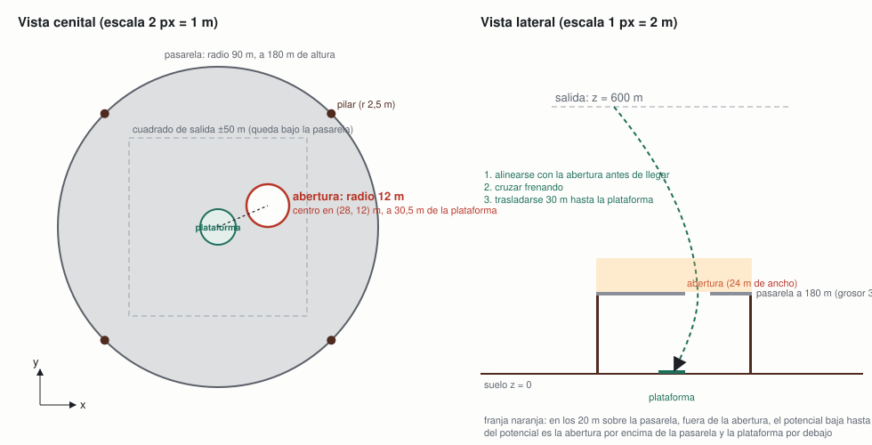

# Ambiente v0.4 · nivel 2 (v1): pasarela con abertura desplazada

**Equipo Alpha Centauri · ficha 02 Rocket Landing · 6 de noviembre de 2026**

Misión de la ficha: *aterrizar en una plataforma con velocidad e inclinación seguras y combustible limitado.* El nivel 2 añade **una decisión de ruta en dos tiempos**: una pasarela cubre la plataforma y hay que entrar por su única abertura, desplazada del centro, y después trasladarse por debajo hasta la plataforma.

Esta ficha describe lo que cambia respecto al nivel 1 ([ambiente-v0.1.md](ambiente-v0.1.md)): el entorno Gymnasium `RocketLanding3D-N2-v1` ([`rocket_env/pasarela.py`](../rocket_env/pasarela.py)) hereda la física, la atmósfera, el viento, el combustible, los pasos y las reglas de aterrizaje del nivel 1 sin tocar un número. Sustituye al ambiente 0.2 con torres ([ambiente-v0.2.md](ambiente-v0.2.md)), que queda retirado: el equipo decidió el 6 de noviembre cambiar el obstáculo por uno que obligue a una decisión más clara, y los modelos de 0.2 siguen siendo reproducibles como históricos.

## Mision y mapa



| Elemento | Dónde | Dimensiones |
|---|---|---|
| Plataforma, zona de vuelo, salida | como en v0.1 | radio 10 m; cilindro de 300 × 1200 m; salida a 600 m sobre x, y ∈ [−50, 50] m |
| Pasarela | disco horizontal centrado en la plataforma, a 180 m de altura | radio 90 m, grosor 3 m |
| Abertura | círculo en la pasarela, centrado en (28, 12) m (a 30,5 m del centro) | radio 16 m; con el fuselaje de 3 m, 13 m de margen |
| Pilares | cuatro, en el borde de la pasarela, azimuts 45°, 135°, 225°, 315° | radio 2,5 m, altura 180 m |

La pasarela tiene 90 m de radio para cubrir todo el cuadrado de salida (su diagonal llega a 70,7 m del centro): **no se puede rodear**, la única vía es la abertura. La abertura no cae sobre la plataforma (su borde más cercano queda a 14,5 m del centro), así que después de cruzarla hay que trasladarse 30 m en horizontal mientras se baja de 180 m a 0 frenando. Los pilares están fuera del cuadrado de salida; solo molestan a quien se desvíe mucho.

**Por qué este diseño.** La guía pide para el nivel 2 "más decisiones (rutas, obstáculos…)". Con las torres de 0.2 la ruta recta solo cruzaba una torre en el 30 % de las salidas; con la pasarela, la ruta recta choca siempre salvo que la salida caiga sobre la abertura (menos del 5 % del cuadrado). La decisión es inevitable y se ve en el replay: el cohete tiene que irse hacia la abertura y volver.

## Variables y unidades

Todo lo de v0.1, más:

| Variable | Significado | Unidad | Rango | Visible para el agente |
|---|---|---|---|---|
| (a_x, a_y, r_a) | centro y radio de la abertura; fijos | m | tabla anterior | sí, como margen r_a − d_a; su posición, a través del objetivo de la fase |
| (o_x, o_y) | objetivo de la fase: la abertura por encima de la pasarela, la plataforma (0, 0) por debajo | m | — | sí, como posición relativa o − p |
| H, R, g | altura, radio y grosor de la pasarela; fijos | m | 180, 90, 3 | H sí, como altura restante hasta la pasarela |
| d_a | distancia horizontal del eje del cohete al centro de la abertura | m | ≥ 0 | sí, como margen r_a − d_a (positivo dentro de la abertura) |
| sobre_pasarela | el cohete está por encima de la pasarela (z > H + g/2) | 0/1 | — | se deduce del signo de H − z; está en `info["sobre_pasarela"]` |

Constante nueva: radio del fuselaje 3 m (solo para la colisión; la física sigue siendo de masa puntual).

## Observaciones y acciones

**Observación**: 20 valores. Los 16 primeros son exactamente los del nivel 1; después: `o_x − x`, `o_y − y` (posición relativa del **objetivo de la fase**: el centro de la abertura mientras el cohete está por encima de la pasarela y la plataforma una vez debajo, como un sistema de navegación que da el siguiente punto de paso), `H − z` (altura que queda hasta la pasarela; negativa una vez debajo) y `r_a − d_a` (margen hasta el borde de la abertura; positivo si el eje está dentro). El objetivo de la fase es la misma referencia que usa el potencial de la recompensa. Es una **familia nueva de modelos**: una red del nivel 1 espera 16 entradas y una del nivel 2 con torres, 25. `AdaptadorN1` recorta la observación a los 16 valores del nivel 1 para evaluar un modelo del nivel 1 a ciegas.

**Acción**: la misma del nivel 1. Los agentes PPO usan la acción relativa v2.

## Dinamica

Igual que en v0.1. Reglas nuevas, comprobadas en cada paso de física (0,1 s):

- **Pasarela.** Si entre dos pasos de física el cohete cruza el plano de la pasarela (o queda dentro de su grosor) estando a menos de 90 m del centro y con el eje a más de r_a − 3 m del centro de la abertura, la época termina con "colisión". Cruzar por la abertura es legal en los dos sentidos.
- **Pilares.** Como las torres de 0.2: eje a menos de 2,5 + 3 m del eje del pilar y por debajo de su cima.

## Recompensa

Potencial del nivel 1 con dos cambios:

Φ = −d_obj/5 − v_h − |vz − v_seg(z)| − z/10 − 8 · c

- **d_obj** es la distancia horizontal **a la abertura** mientras el cohete está por encima de la pasarela, y **a la plataforma** una vez debajo. Así el potencial guía las dos fases de la decisión.
- **c** castiga acercarse a la pasarela fuera de la abertura: c = 1 − (z − H)/20 cuando el cohete está en los 20 m por encima de la pasarela y su eje fuera de la abertura (0 en otro caso). Vale hasta 8 puntos, como en 0.2.

Como es una diferencia de potencial, no cambia qué política es óptima; el salto del potencial al cruzar la pasarela es una recompensa de una sola vez que no depende de la política.

Resultado nuevo al terminar: **colisión, −100** (pasarela o pilar). Los otros cinco no cambian.

## Exito, fracaso y limite de tiempo

Como en v0.1; "colisión" se suma a los fracasos con `terminated=True`. El límite sigue siendo 50 pasos: desde 600 m, pasar por la abertura (180 m) y trasladarse 30 m debajo cabe con margen (los modelos del nivel 1 aterrizan en 30–40 pasos).

## Metricas e incidente

Las tres métricas de v0.1 en la misma suite v1 (200 épocas, semillas desde 10 000 000, con y sin viento de 15 m/s), más el recuento de colisiones.

**Dificultad del nivel**, medida con el recomendado del nivel 1 jugando a ciegas (`python incidente.py --run ppo-v2-v0.1-s1 --ambiente RocketLanding3D-N2-v1`):

| Controlador (nivel 1) | En el nivel 1 | Bajo la pasarela, a ciegas | Colisiones |
|---|---|---|---|
| `ppo-v2-v0.1-s1`, recomendado del nivel 1 | 198/200 (99 %) | 10/200 (5 %) | 190 |
| mismo modelo, con viento de 15 m/s | 144/200 (72 %) | 7/200 (3,5 %) | 189 |

Los 10 aterrizajes a ciegas son salidas que caen sobre la abertura por casualidad. Con las torres de 0.2, el mismo modelo conservaba el 72 %: la pasarela es un nivel mucho más exigente.

**Incidente / perturbación:** el mismo viento de 15 m/s de v0.1; el nivel 3 (v1) lo convierte en operación normal ([ambiente-v0.5.md](ambiente-v0.5.md)).

## Cinco transiciones

Pendientes del primer modelo aceptado del nivel 2 v1 (`python cli.py transiciones --run <id>`); se añaden al cerrar el experimento 5.

## Posibles trampas y decisiones pendientes

- **Flotar sobre la pasarela.** Quedarse por encima hasta agotar los pasos evita la colisión pero cuesta "sin pasos" (−100) y el término −z/10, que siempre empuja a bajar.
- **Pasar la abertura demasiado rápido.** Debajo quedan 180 m para frenar desde la velocidad de cruce; v_seg(180) = 14,4 m/s. Cruzar a más de 30 m/s obliga a un frenado al límite del empuje. El agente tiene que aprender a llegar a la abertura ya frenando.
- **Salir por fuera de la pasarela.** Rodearla no es posible (cubre el cuadrado de salida), pero un cohete que derive más de 90 m podría bajar por fuera y entrar por debajo: legal, caro en pasos y combustible, y el castigo de proximidad no lo impide. Se vigilará en los replays.
- **Trayectoria por debajo de la pasarela con viento.** En el nivel 3 (v1) el viento empuja al cohete lateralmente durante el traslado de 30 m; es la parte sensible de la intervención.
- **La abertura es fija.** Un modelo podría memorizar su posición; una abertura aleatoria por época sería una versión 0.6. Decisión pendiente.
- **Visibilidad en el replay.** La pasarela se dibuja translúcida y se vuelve casi transparente cuando queda entre la cámara y el cohete, para no taparlo.

## Experimentos del nivel 2 (v1)

Se documentan en `configs/<run_id>.json` y se resumen aquí al cerrar cada uno (experimento 5 de MLflow, `experimento-5-pasarela`).

**Intento abortado (6 de noviembre, sin run_id).** Primera versión de la observación, con la posición relativa de la abertura fija en las entradas 16 y 17, y transferencia simple desde `ppo-v2-v0.1-s1` (entradas nuevas en cero). A los 320 000 pasos de 1,5 M la evaluación sin ruido seguía en 2 % y la tasa de entrenamiento en 1 %: la política heredada volaba hacia la plataforma y chocaba con la pasarela antes de aprender a usar las entradas nuevas. Se detuvo y se cambió el diseño a la observación "objetivo de la fase" con herencia de pesos (`TRANSFERENCIA_ENTRADAS`), que hace que la política de partida vuele hacia la abertura desde el primer paso.

## Anexo: cómo reproducir

```bash
python -m pytest tests/test_ambiente_pasarela.py                                   # contrato del nivel 2 v1 (y 3 v1)
python incidente.py --run ppo-v2-v0.1-s1 --ambiente RocketLanding3D-N2-v1           # dificultad: modelo del nivel 1 a ciegas
.venv-prefect/bin/python pipelines/entrenar_publicar.py --ambiente RocketLanding3D-N2-v1 --seed 0 \
    --run-id ppo-pasarela-transfer-1m5-v0.4-s0 --desde ppo-v2-v0.1-s1 --total-timesteps 1500000 --baseline ppo-v2-v0.1-s1 --push
```
