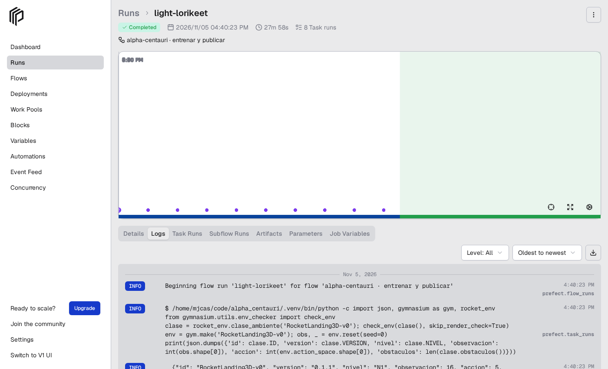

# Pipeline orquestado (Prefect)

`entrenar_publicar.py` lleva una configuración nueva desde el entrenamiento hasta el catálogo servido, en ocho etapas
con criterio de aceptación. Cada etapa es un comando del proyecto (los mismos que se usan a mano), ejecutado por Prefect,
que registra el estado, la duración y los logs de cada una.

| # | Etapa | Qué hace | Falla si… |
|---|---|---|---|
| 1 | validar | `check_env` del ambiente del nivel, versión y nivel, suite v1 presente, estado de git | el ambiente no cumple el contrato de Gymnasium o la suite no es la esperada |
| 2 | probar | `pytest tests/test_ambiente.py tests/test_ambiente_n2.py` | alguna prueba del contrato falla |
| 3 | entrenar | `python cli.py entrenar-ppo --ambiente … --seed … --run-id …` (`--desde` para transferencia); con `--run-existente` se salta | el entrenamiento termina con error |
| 4 | evaluar | `python panel.py`: suite v1, 200 épocas normales y 200 con viento de 15 m/s → `evaluacion.json` | — |
| 5 | registrar | `configs/<id>.json` (hipótesis, cambio, baseline, presupuesto), `manifests/<id>.json` (sección 11), etiquetas en MLflow, `cli.py verificar` (SHA-256) | las huellas no coinciden |
| 6 | decidir | compara con el recomendado actual del nivel: acepta si gana ≥ 2 puntos de tasa, no pierde más de 5 con viento y (nivel 2) no choca más; escribe estado y decisión en `configs/` y MLflow | — (rechazar no es fallar) |
| 7 | publicar | si se aceptó, `catalogo.py recomendar`; commit con ejecución, configs, manifests, catálogo, MLflow y evidencia; con `--push`, push (dispara Render y Vercel) | git falla |
| 8 | comprobar | con push: espera a que `GET /version` de la API pública sirva el commit, comprueba el recomendado del nivel en `/catalogo` y hace una evaluación corta; sin push: lo mismo contra la API en local | la API no sirve el commit en el tiempo dado o sirve otro catálogo → rollback con `python catalogo.py restaurar --nivel …` |

La evidencia de cada ejecución queda en `ejecuciones/<run_id>-<fecha>.json` (resultado de cada etapa, decisión, commit,
id del *flow run* de Prefect) y se versiona en git. La interfaz de Prefect se abre con `.venv-prefect/bin/prefect server start`
(http://127.0.0.1:4200; entra por la raíz y navega a *Runs*, los enlaces profundos devuelven 404) y muestra los *flow runs* con sus tareas, tiempos y logs.
Los flujos que se ejecutan sin servidor levantan uno efímero y guardan sus runs en la misma base de datos (`~/.prefect`), así que aparecen igual.



## Entorno

Prefect 3.8 no convive con la versión de FastAPI que usa la API (0.162: quitó `Body(min_items=)`), y su interfaz necesita FastAPI ≥ 0.139 (`FastAPI.frontend`); la 0.139.1 cumple las dos. Por eso el orquestador tiene su propio entorno:

```bash
python -m venv .venv-prefect && .venv-prefect/bin/pip install -r requirements-pipeline.txt
```

Las etapas se ejecutan con el intérprete del proyecto (`.venv/bin/python`, o la variable `ALPHA_PYTHON`).

## Uso

```bash
# ensayo sin tocar git, con una ejecución ya entrenada (comprueba la API en local)
.venv-prefect/bin/python pipelines/entrenar_publicar.py --run-existente ppo-n2-transfer-1m5-v0.2-s0 --sin-commit

# ejecución real: entrena, decide, publica y comprueba la API pública
.venv-prefect/bin/python pipelines/entrenar_publicar.py --ambiente RocketLanding3D-v0 --seed 1 --run-id ppo-v2-v0.1-s1 \
    --baseline ppo-v2-v0.1-s0 --hipotesis "…" --cambio "…" --push

# nivel 2 con transferencia desde el modelo del nivel 1
.venv-prefect/bin/python pipelines/entrenar_publicar.py --ambiente RocketLanding3D-N2-v0 --seed 1 --run-id ppo-n2-transfer-1m5-v0.2-s1 \
    --desde ppo-v2-v0.1-s0 --total-timesteps 1500000 --baseline ppo-n2-transfer-1m5-v0.2-s0 --hipotesis "…" --push
```

Variables: `ALPHA_API_URL` (API pública, por defecto https://alpha-centauri-api.onrender.com), `--espera-api` (segundos máximos
para que el despliegue sirva el commit, 900 por defecto).

## Criterio de aceptación

Un candidato sustituye al recomendado de su nivel solo si en la suite v1 gana al menos 2 puntos de tasa de aterrizaje, con
viento de 15 m/s no pierde más de 5 puntos respecto al recomendado y, en el nivel 2, no tiene más colisiones. Si no lo cumple
queda **rechazado** (con su evidencia versionada, igual que los aceptados). Si no hay recomendado en el nivel, se acepta.
Las constantes están al principio de `entrenar_publicar.py`.

## Rollback

El catálogo guarda el anterior de cada nivel. `python catalogo.py restaurar --nivel N1 --motivo "…"` + commit + push devuelve
la versión anterior; la etapa 8 (o `GET /version`) comprueba qué commit y qué catálogo sirve la API.
